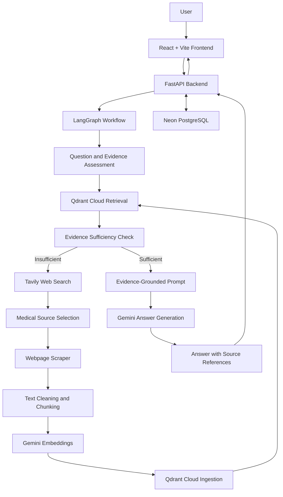
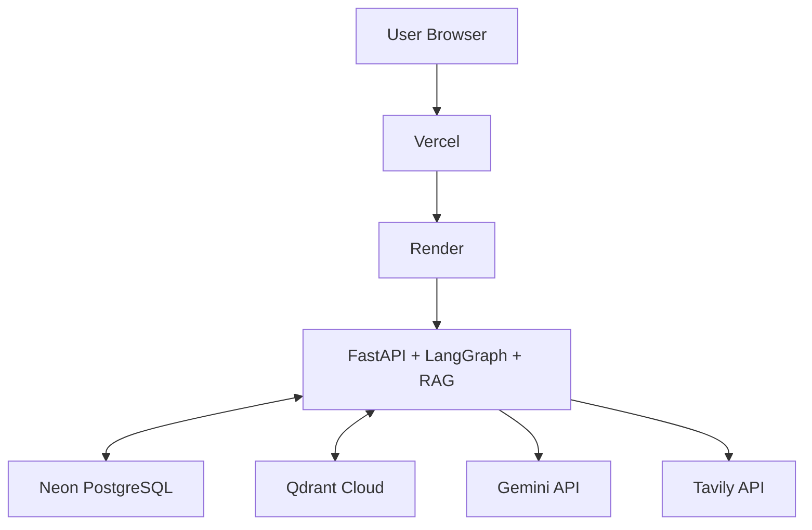

# CareRoot 🩺

### Evidence-Based Healthcare Assistant Powered by RAG, LangGraph, React and FastAPI

CareRoot is an AI-powered healthcare information assistant that answers health-related questions using evidence retrieved from trusted medical sources.

It combines Retrieval-Augmented Generation (RAG), semantic search, automated web research, document processing and LangGraph orchestration to generate evidence-grounded healthcare responses with source references.

CareRoot uses a modern web architecture with a **React + Vite frontend** and a **FastAPI backend**, while its existing LangGraph and RAG pipeline handles the core AI workflow.

Instead of relying entirely on a language model's internal knowledge, CareRoot retrieves relevant medical evidence and uses it as the factual basis for its answers.

> **Disclaimer:** CareRoot provides general healthcare information for educational purposes only. It does not diagnose medical conditions or replace advice from qualified healthcare professionals.

---

## ✨ Key Features

- **Evidence-grounded healthcare answers:** Generates responses using retrieved medical documents.
- **Trusted-source retrieval:** Uses approved medical sources such as WHO, CDC, NIH/NIDDK and NICE.
- **Cloud vector database:** Uses Qdrant Cloud to store and retrieve medical document embeddings.
- **Semantic search:** Uses Gemini embeddings to retrieve relevant information based on meaning.
- **Automated web research:** Uses Tavily to discover relevant healthcare resources when existing evidence is insufficient.
- **Webpage scraping:** Extracts and cleans relevant content from selected medical webpages.
- **Document chunking:** Splits extracted articles into smaller chunks while preserving source metadata.
- **Evidence-sufficiency checks:** Evaluates relevance, source authority, minimum evidence count and basic question coverage.
- **LangGraph orchestration:** Coordinates retrieval, research fallback, ingestion and answer generation.
- **Source traceability:** Includes source titles and URLs to help users inspect supporting evidence.
- **Modern React interface:** Provides an interactive chat experience with conversation history.
- **FastAPI backend:** Exposes REST API endpoints connecting the frontend with the AI workflow.
- **Persistent conversations:** Uses PostgreSQL to store chat threads and messages.
- **Markdown rendering:** Displays structured AI responses, including headings, lists, tables and code formatting.

---

## 🏗️ System Architecture

CareRoot follows a frontend-backend architecture with a LangGraph-powered RAG pipeline.

### High-Level Architecture



### Application Architecture

CareRoot consists of three main layers:

**1. Frontend — React + Vite**

Responsible for the user interface and interaction.

- Displays the chat interface.
- Manages conversation selection.
- Creates new conversations.
- Supports renaming and deleting conversations.
- Sends user messages to the backend.
- Renders AI responses using Markdown.

**2. Backend — FastAPI**

Acts as the communication layer between the frontend and the AI system.

- Exposes REST API endpoints.
- Receives healthcare questions.
- Calls the LangGraph workflow.
- Manages conversation-related operations.
- Communicates with the PostgreSQL database.
- Returns generated responses to the frontend.

**3. AI Processing — LangGraph + RAG**

Handles the healthcare question-answering workflow.

- Retrieves relevant medical evidence.
- Evaluates evidence sufficiency.
- Performs web research when required.
- Processes and ingests new documents.
- Generates evidence-grounded answers.

---

## 🔄 RAG Workflow

CareRoot uses a retrieval and generation pipeline to produce evidence-grounded healthcare responses.

### 1. Question Processing

The user submits a healthcare question through the React frontend.

FastAPI receives the request and invokes the LangGraph workflow.

### 2. Semantic Retrieval

The question is embedded using Google's Gemini embedding model and compared with vectors stored in Qdrant Cloud.

The retrieval system fetches candidate medical document chunks and evaluates their relevance.

### 3. Evidence Validation

CareRoot performs several checks:

- Relevance score threshold.
- Approved medical-source domain validation.
- Minimum number of relevant chunks.
- Basic coverage of the question's topic and recognized requirements.

The historical default relevance threshold is `0.55`, and the historical default minimum number of relevant chunks is `2`. These are configurable heuristics, not calibrated medical-confidence scores. Verify the current configuration in the source code.

### 4. Web Research Fallback

When existing evidence does not satisfy the configured checks, the workflow can use Tavily to search for relevant healthcare information.

The scraper extracts article content and associated metadata, such as:

- Source URL.
- Article title.
- Domain.
- Document type.
- Search query.

Only successfully extracted content proceeds to ingestion.

### 5. Document Ingestion

The extracted article is converted into LangChain `Document` objects and split into smaller chunks.

Historical chunking configuration:

| Setting         |                         Value |
| --------------- | ----------------------------: |
| Chunk size      |              1,000 characters |
| Chunk overlap   |                150 characters |
| Vector database |                  Qdrant Cloud |
| Embedding model | `models/gemini-embedding-001` |

Source metadata is preserved to support filtering, traceability and citation handling.

### 6. Answer Generation

The retrieved evidence is supplied to the healthcare answer-generation prompt.

CareRoot is instructed to:

- Answer the user's question directly.
- Ground factual medical claims in retrieved evidence.
- Acknowledge missing or insufficient information.
- Avoid unsupported medical claims and invented citations.
- Include relevant source titles and URLs.
- Avoid diagnosing users or replacing professional medical advice.

---

## 🧰 Technology Stack

| Component                 | Technology                           |
| ------------------------- | ------------------------------------ |
| Frontend                  | React                                |
| Frontend tooling          | Vite                                 |
| Styling                   | CSS                                  |
| Markdown rendering        | React Markdown, remark-gfm           |
| Backend                   | FastAPI                              |
| Programming language      | Python                               |
| API communication         | REST API, Fetch                      |
| Workflow orchestration    | LangGraph                            |
| LLM integration           | LangChain Google GenAI               |
| Language model            | Gemini                               |
| Embedding model           | Gemini `models/gemini-embedding-001` |
| Vector database           | Qdrant Cloud                         |
| Semantic retrieval        | LangChain Qdrant integration         |
| Conversation database     | Neon PostgreSQL                      |
| Web search                | Tavily                               |
| Web scraping              | Requests, BeautifulSoup              |
| Document processing       | LangChain Text Splitters             |
| Environment configuration | python-dotenv                        |
| Observability             | LangSmith                            |

---

## 📂 Project Structure

The following is a representative structure of the updated application. Exact filenames and modules should be verified against the current repository.

```text
CareRoot/
│
├── api/
│   └── main.py
│
├── frontend/
│   ├── public/
│   ├── src/
│   │   ├── App.jsx
│   │   ├── App.css
│   │   └── main.jsx
│   │
│   ├── index.html
│   ├── package.json
│   └── vite.config.js
│
├── rag/
│   ├── __init__.py
│   ├── embeddings.py
│   ├── vector_store.py
│   ├── retrieval.py
│   ├── ingestion.py
│   ├── loader.py
│   └── prompts.py
│
├── scrapper/
│   └── tavily_scrapper.py
│
├── backend_step4.py
├── database.py
├── app.py
│
├── requirements.txt
├── .env
├── .gitignore
└── README.md
```

### Module Responsibilities

| File / Directory              | Responsibility                                            |
| ----------------------------- | --------------------------------------------------------- |
| `frontend/src/App.jsx`        | Main React application and chat interface                 |
| `frontend/src/App.css`        | Frontend styling                                          |
| `api/main.py`                 | FastAPI application and API endpoints                     |
| `backend_step4.py`            | LangGraph workflow and response generation                |
| `database.py`                 | PostgreSQL connection and conversation operations         |
| `rag/embeddings.py`           | Gemini embedding configuration                            |
| `rag/vector_store.py`         | Qdrant initialization and document storage                |
| `rag/retrieval.py`            | Document retrieval, relevance scoring and evidence checks |
| `rag/ingestion.py`            | Validates, splits and stores scraped articles             |
| `rag/loader.py`               | Converts extracted content into LangChain documents       |
| `rag/prompts.py`              | Evidence-grounded healthcare answer prompts               |
| `scrapper/tavily_scrapper.py` | Healthcare web search and webpage extraction              |
| `app.py`                      | Original Streamlit application retained as a backup       |

---

## ⚙️ Local Installation and Setup

### Prerequisites

Make sure you have:

- Python installed.
- Node.js and npm installed.
- Git installed.
- A Gemini API key.
- A Tavily API key.
- A Qdrant Cloud account and configured cluster.
- A Neon PostgreSQL database.

### 1. Clone the Repository

```bash
git clone https://github.com/Ayushkr240/CareRoot.git

cd CareRoot
```

### 2. Create a Python Virtual Environment

On Windows PowerShell:

```powershell
python -m venv .venv

.\.venv\Scripts\Activate.ps1
```

### 3. Install Backend Dependencies

```powershell
pip install -r requirements.txt
```

Ensure that the required Qdrant integration packages are included:

```text
langchain-qdrant
qdrant-client
```

The backend also requires the dependencies used by FastAPI, LangGraph, LangChain, Gemini, Tavily, PostgreSQL and webpage processing.

### 4. Configure Environment Variables

Create a `.env` file in the project root.

The following are the core credentials used by the application:

```env
GEMINI_API_KEY=your_gemini_api_key

TAVILY_API_KEY=your_tavily_api_key

QDRANT_URL=your_qdrant_cluster_url

QDRANT_API_KEY=your_qdrant_api_key

# PostgreSQL connection configuration
# Use the exact variable name expected by database.py.
YOUR_DATABASE_URL_VARIABLE=your_neon_postgresql_connection_string

# Add LangSmith credentials if tracing is enabled.
```

**Important:** `YOUR_DATABASE_URL_VARIABLE` is a placeholder, not a literal environment variable name. Check `database.py` and the current application configuration for the actual variable name.

Never commit `.env` to GitHub.

### 5. Start the FastAPI Backend

Run the following command from the project root:

```powershell
uvicorn api.main:app --reload
```

The backend should be accessible at:

```text
http://127.0.0.1:8000
```

FastAPI documentation:

```text
http://127.0.0.1:8000/docs
```

### 6. Start the React Frontend

Open another terminal:

```powershell
cd frontend

npm install

npm run dev
```

Vite will display the local frontend URL, typically:

```text
http://localhost:5173
```

Open that address in your browser to access CareRoot.

---

## 🔌 FastAPI Endpoints

The frontend communicates with the backend through REST API endpoints.

The currently documented API routes are:

| Method | Endpoint                          | Purpose                                |
| ------ | --------------------------------- | -------------------------------------- |
| GET    | `/api/health`                     | Backend health check                   |
| POST   | `/api/chats`                      | Create a chat                          |
| GET    | `/api/chats`                      | Retrieve chat threads                  |
| GET    | `/api/chats/{thread_id}`          | Retrieve a chat and its messages       |
| POST   | `/api/chats/{thread_id}/messages` | Send a message and generate a response |
| PATCH  | `/api/chats/{thread_id}`          | Update a chat title                    |
| DELETE | `/api/chats/{thread_id}`          | Delete a conversation                  |

These routes describe the current intended API contract; verify them against `api/main.py` before making client-side or deployment changes.

---

## 🗄️ Database Architecture

CareRoot uses two separate cloud databases for different responsibilities.

### 1. Qdrant Cloud — Medical Knowledge Storage

Qdrant stores vectorized medical document chunks.

It is responsible for:

- Storing document embeddings.
- Semantic similarity search.
- Retrieving relevant medical evidence.
- Preserving document metadata.
- Supporting metadata-based filtering.

Each stored record contains document content and associated metadata, including source information.

### 2. Neon PostgreSQL — Conversation Storage

Neon PostgreSQL stores application conversation data.

It is responsible for:

- Creating chat threads.
- Retrieving conversation history.
- Saving user messages.
- Saving assistant responses.
- Updating conversation titles.
- Deleting conversations.

**Database separation:** Qdrant stores medical knowledge, whereas Neon stores application conversation data. These databases serve different purposes and should not be confused.

---

## 🛡️ Medical Source Policy and Safety

CareRoot's retrieval system uses approved medical source domains:

- `who.int`
- `cdc.gov`
- `nih.gov`
- `nice.org.uk`

Subdomains of these domains are accepted by the historical domain-validation logic.

Domain approval does not independently verify the accuracy, currency or clinical suitability of every article.

CareRoot should:

- Acknowledge insufficient evidence.
- Avoid fabricating sources or medical claims.
- Avoid providing definitive diagnoses.
- Encourage users to consult qualified healthcare professionals for individual medical assessment.
- Direct users with urgent or potentially life-threatening symptoms to appropriate emergency medical services.

---

## ☁️ Deployment Architecture

CareRoot is intended to use separate hosting platforms for its frontend and backend.

### Production Architecture



### Frontend Deployment — Vercel

The React + Vite frontend will be deployed on Vercel.

Responsibilities:

- Hosting the production frontend.
- Serving the built React application.
- Delivering frontend assets.
- Connecting to the deployed FastAPI backend.

### Backend Deployment — Render

The FastAPI backend will be deployed as a Render Web Service.

Responsibilities:

- Running the FastAPI application.
- Executing the LangGraph workflow.
- Handling RAG retrieval and ingestion.
- Communicating with external AI services.
- Managing conversation operations.

### Deployment Configuration

Before production deployment, configure:

**On Render:**

- Python runtime and dependencies.
- Backend start command.
- Gemini API credentials.
- Tavily API credentials.
- Qdrant credentials.
- Neon PostgreSQL connection.
- Production CORS origins.
- Any additional configuration required by the LangGraph workflow.

**On Vercel:**

- Frontend project root directory: `frontend`.
- Build command: `npm run build`.
- Output directory: `dist`.
- Production API base URL pointing to the deployed Render backend.

The frontend must use the deployed backend URL instead of its local development URL.

### Automatic Deployment

The intended workflow uses GitHub-connected deployments.

```text
Local Development
       |
       v
    GitHub
       |
       +--------------------+
       |                    |
       v                    v
    Vercel                Render
  Frontend              Backend
       |                    |
       v                    v
 Updated UI           Updated API
```

Frontend and backend deployments can be managed independently.

A frontend-only change should not require a backend deployment, and a backend-only change should not require a frontend deployment.

Deployment filters and automatic deployment settings must be configured on the respective platforms.

**Deployment status:** This section documents the planned deployment architecture. Production deployment and live endpoint verification are separate steps.

---

## 🧪 Testing and Validation

CareRoot should be tested at multiple levels.

### Backend Testing

- Verify FastAPI starts successfully.
- Check the health endpoint.
- Verify PostgreSQL connectivity.
- Verify Qdrant connectivity.
- Test conversation creation and retrieval.
- Test the LangGraph response-generation workflow.
- Test Tavily fallback and document ingestion.
- Verify external API error handling.

### Frontend Testing

- Verify the React application builds successfully.
- Test chat creation.
- Test conversation selection.
- Test message submission.
- Test Markdown rendering.
- Test chat renaming and deletion.
- Verify API connectivity with the deployed backend.

### End-to-End Testing

- Submit healthcare questions.
- Verify retrieved evidence and source URLs.
- Test questions with insufficient existing evidence.
- Test the web research fallback.
- Verify conversation persistence.
- Test application behavior when external services fail.

A successful retrieval test does not guarantee clinical correctness, complete evidence coverage or successful behavior for every fallback path.

---

## 🚧 Current Limitations

- Evidence sufficiency is evaluated using deterministic heuristics rather than clinical validation.
- Basic question-coverage checks cannot guarantee that every requested detail is present.
- Answer completeness depends on the quality and content of retrieved documents.
- Tavily searches and webpage extraction may fail because of blocked pages, unsupported formats or unavailable sources.
- External API availability and rate limits can affect the workflow.
- Embedding and LLM usage may introduce operational costs.
- Source-domain approval does not guarantee that an article is authoritative for every specific medical question.
- Production deployment, monitoring and reliability still require validation.

---

## 🔮 Future Improvements

Potential future improvements include:

- Better question-aware retrieval and evidence-coverage checks.
- More comprehensive ingestion of authoritative medical guidance.
- Automated evaluation of answer completeness and source faithfulness.
- Improved handling of unavailable sources and API failures.
- More robust integration testing for the complete LangGraph workflow.
- Monitoring of retrieval quality and response latency.
- Stronger safeguards for emergency and high-risk healthcare questions.
- Improved frontend user experience.
- Production monitoring and deployment reliability improvements.

---

## 👨‍💻 Author

**Ayush Kumar**

GitHub: [Ayushkr240](https://github.com/Ayushkr240)

Project Repository: [CareRoot](https://github.com/Ayushkr240/CareRoot)

---

## 📜 Disclaimer

CareRoot is an educational healthcare-information project. Its responses may be incomplete or inaccurate and must not be used as a substitute for professional medical diagnosis, treatment or emergency care.

Always consult a qualified healthcare professional for personal medical concerns.
