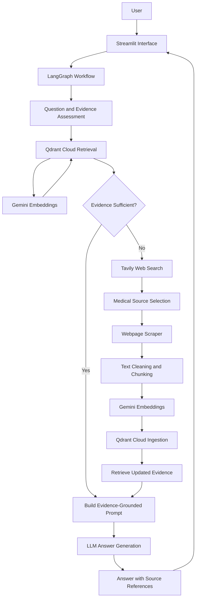

# CareRoot 🩺

### Evidence-Based Healthcare Assistant Powered by RAG and LangGraph

CareRoot is an AI-powered healthcare information assistant that answers health-related questions using retrieved information from trusted medical sources. It combines Retrieval-Augmented Generation (RAG), web research, document processing, and a LangGraph workflow to generate evidence-grounded responses with source references.

Instead of relying entirely on the language model's internal knowledge, CareRoot retrieves relevant medical evidence and uses it as the factual basis for its answers.

> **Disclaimer:** CareRoot provides general healthcare information for educational purposes only. It does not diagnose medical conditions or replace advice from qualified healthcare professionals.

---

## ✨ Key Features

- **Evidence-grounded healthcare answers:** Generates responses using retrieved medical documents.
- **Trusted-source retrieval:** Supports approved sources such as WHO, CDC, NIH/NIDDK, and NICE.
- **Cloud vector database:** Uses Qdrant Cloud to store and retrieve medical document embeddings.
- **Semantic search:** Uses Gemini embeddings to find relevant information based on meaning rather than exact keyword matches.
- **Automated web research:** Uses Tavily to discover relevant healthcare resources when existing evidence is insufficient.
- **Webpage scraping:** Extracts and cleans relevant content from selected medical webpages.
- **Document chunking:** Splits extracted articles into smaller chunks while preserving source metadata.
- **Evidence-sufficiency checks:** Evaluates relevance, source authority, minimum evidence count, and basic question coverage.
- **LangGraph orchestration:** Coordinates retrieval, research fallback, ingestion, and answer generation.
- **Source traceability:** Includes source titles and URLs to help users inspect the supporting evidence.
- **Streamlit interface:** Provides an interactive chat interface for healthcare questions.

---

## 🏗️ System Architecture

CareRoot follows a Retrieval-Augmented Generation architecture orchestrated through LangGraph.

### High-Level Architecture



**Architecture overview:**

1. **User interface:** Streamlit receives the healthcare question.
2. **Workflow orchestration:** LangGraph coordinates the retrieval and response-generation process.
3. **Initial retrieval:** CareRoot searches Qdrant Cloud for semantically relevant medical document chunks.
4. **Evidence assessment:** Retrieved chunks are checked for relevance, approved source domains, minimum chunk count, and basic question coverage.
5. **Research fallback:** If the evidence is insufficient, the workflow can use Tavily to discover relevant medical sources.
6. **Content extraction:** The scraper extracts article text and source metadata.
7. **Ingestion:** The extracted article is converted into LangChain documents, split into chunks, embedded, and stored in Qdrant.
8. **Updated retrieval:** CareRoot retrieves evidence after ingestion.
9. **Answer generation:** The LLM receives the healthcare question and retrieved evidence and generates a grounded response with source references.

The sufficiency check is a deterministic heuristic, not a clinical validation system. Passing it does not guarantee that the evidence is complete or medically sufficient.

---

## 🔄 RAG Workflow

CareRoot uses the following retrieval and generation pipeline.

### 1. Question Processing

The user submits a healthcare question through Streamlit. The LangGraph workflow determines the next step based on the available evidence.

### 2. Semantic Retrieval

The question is embedded using Google's Gemini embedding model and compared with the vectors stored in Qdrant Cloud.

The system retrieves candidate document chunks and evaluates their relevance.

### 3. Evidence Validation

CareRoot performs several checks:

- Relevance score threshold.
- Approved medical-source domain validation.
- Minimum number of relevant chunks.
- Basic coverage of the question's topic and recognized requirements.

The current default relevance threshold is `0.55`, and the default minimum number of relevant chunks is `2`. These are configurable heuristics, not calibrated medical-confidence scores.

### 4. Web Research Fallback

When existing evidence does not satisfy the configured checks, the workflow can use Tavily to search for relevant healthcare information.

The scraper then extracts article text and associated metadata, such as:

- Source URL.
- Article title.
- Domain.
- Document type.
- Search query.

Only successfully extracted content proceeds to ingestion.

### 5. Document Ingestion

The article text is converted into LangChain `Document` objects and split into chunks.

Default chunking configuration:

| Setting         |                         Value |
| --------------- | ----------------------------: |
| Chunk size      |              1,000 characters |
| Chunk overlap   |                150 characters |
| Vector database |                  Qdrant Cloud |
| Embedding model | `models/gemini-embedding-001` |

Source metadata is preserved on each chunk to support filtering, traceability, and citation handling.

### 6. Answer Generation

The retrieved evidence is inserted into the healthcare answer-generation prompt.

CareRoot is instructed to:

- Answer the user's question directly.
- Ground factual medical claims in retrieved evidence.
- Acknowledge missing or insufficient information.
- Avoid unsupported medical claims and invented citations.
- Include relevant source titles and URLs.
- Avoid diagnosing users or replacing professional medical advice.

---

## 🧰 Technology Stack

| Component                 | Technology                           |
| ------------------------- | ------------------------------------ |
| Frontend                  | Streamlit                            |
| Programming language      | Python                               |
| Workflow orchestration    | LangGraph                            |
| LLM integration           | LangChain Google GenAI               |
| Embedding model           | Gemini `models/gemini-embedding-001` |
| Vector database           | Qdrant Cloud                         |
| Semantic retrieval        | LangChain Qdrant integration         |
| Web search                | Tavily                               |
| Web scraping              | Requests, BeautifulSoup              |
| Document processing       | LangChain Text Splitters             |
| Environment configuration | python-dotenv                        |

---

## 📂 Project Structure

The following structure describes the main modules used by the current workflow. Adjust filenames to match the exact layout of your repository.

```text
CareRoot/
│
├── app.py
│
├── backend_step4.py
│
├── rag/
│   ├── __init__.py
│   ├── embeddings.py
│   ├── vector_store.py
│   ├── retrieval.py
│   ├── ingestion.py
│   ├── loader.py
│   └── prompts.py
│
├── scrapper/
│   └── tavily_scrapper.py
│
├── requirements.txt
├── .env
├── .gitignore
└── README.md
```

### Module Responsibilities

| File                          | Responsibility                                                                                        |
| ----------------------------- | ----------------------------------------------------------------------------------------------------- |
| `app.py`                      | Streamlit interface and user interaction                                                              |
| `backend_step4.py`            | LangGraph workflow and response-generation orchestration                                              |
| `rag/embeddings.py`           | Configures and reuses Gemini embeddings                                                               |
| `rag/vector_store.py`         | Initializes Qdrant, inserts documents, and manages the collection                                     |
| `rag/retrieval.py`            | Retrieves documents, calculates relevance scores, applies filters, and evaluates evidence sufficiency |
| `rag/ingestion.py`            | Validates scraped articles, splits them, and stores their chunks                                      |
| `rag/loader.py`               | Converts article text into LangChain documents and preserves metadata during chunking                 |
| `rag/prompts.py`              | Builds the evidence-grounded healthcare answer prompt                                                 |
| `scrapper/tavily_scrapper.py` | Searches for and extracts relevant healthcare webpage content                                         |

---

## ⚙️ Installation and Setup

### Prerequisites

Make sure you have:

- Python installed.
- Git installed.
- A Gemini API key.
- A Tavily API key.
- A Qdrant Cloud account and configured cluster.

### 1. Clone the Repository

```bash
git clone https://github.com/Ayushkr240/CareRoot.git
cd CareRoot
```

### 2. Create a Virtual Environment

On Windows PowerShell:

```powershell
python -m venv .venv
.\.venv\Scripts\Activate.ps1
```

### 3. Install Dependencies

```bash
pip install -r requirements.txt
```

Ensure the following Qdrant packages are included in your requirements:

```text
langchain-qdrant
qdrant-client
```

Your project also uses LangGraph, LangChain, Google GenAI integration, Streamlit, Tavily, and webpage-processing libraries.

### 4. Configure Environment Variables

Create a `.env` file in the project root:

```env
GEMINI_API_KEY=your_gemini_api_key
TAVILY_API_KEY=your_tavily_api_key

QDRANT_URL=your_qdrant_cluster_url
QDRANT_API_KEY=your_qdrant_api_key
```

Use the actual credentials from your respective providers.

**Security:** Never commit `.env` to GitHub. Add it to `.gitignore` and rotate any credentials accidentally exposed in a public repository.

### 5. Run the Application

```bash
streamlit run app.py
```

Open the local URL printed in the terminal to access CareRoot.

---

## 🗄️ Qdrant Cloud Integration

CareRoot uses Qdrant Cloud as its persistent vector database.

The vector-store module is responsible for:

- Connecting to Qdrant Cloud.
- Initializing the configured collection.
- Determining the vector dimension from the embedding model.
- Storing embedded document chunks with their metadata.
- Performing semantic and relevance-scored searches.
- Filtering retrieved records by metadata.
- Managing stored records when required.

The collection's vector dimensions and distance configuration must match the embedding model and retrieval implementation.

### Document Payload

Each stored record contains the chunk's content and associated metadata. The current payload structure resembles:

```json
{
  "page_content": "Extracted medical article content...",
  "metadata": {
    "source_url": "https://www.who.int/",
    "title": "Medical article title",
    "domain": "www.who.int",
    "document_type": "webpage",
    "chunk_index": 0
  }
}
```

This structure allows CareRoot to retain source attribution and apply metadata-based retrieval filters.

### Database Separation

Qdrant stores vectorized medical document chunks. It should not be confused with the application's conversation-history storage, which is a separate concern.

---

## 🛡️ Medical Source Policy and Safety

CareRoot's retrieval module defines the following approved source domains:

- `who.int`
- `cdc.gov`
- `nih.gov`
- `nice.org.uk`

Subdomains of these domains are accepted by the current domain-validation logic. PubMed Central and PubMed records are explicitly excluded by that logic.

These checks are domain-based safeguards; they do not independently verify the accuracy, currency, or clinical suitability of every article.

CareRoot should clearly acknowledge insufficient evidence and direct users to qualified healthcare professionals when individualized medical assessment is needed. Urgent or potentially life-threatening symptoms require urgent local medical care.

---

## 🧪 Testing and Validation

The Qdrant integration has been tested in the development environment for the following operations:

- Successful connection to Qdrant Cloud.
- Collection initialization.
- Document insertion.
- Semantic similarity retrieval.
- Relevance-scored retrieval.
- Retrieval from approved sources.
- Metadata filtering using a payload index.
- Evidence-sufficiency evaluation.
- Streamlit response generation with source links.

A successful retrieval test does not by itself guarantee clinical correctness, complete symptom coverage, or successful behavior for every fallback path.

### Suggested Additional Tests

1. Ask questions across different healthcare topics.
2. Verify that returned source URLs correspond to the retrieved evidence.
3. Test questions for which the collection contains insufficient evidence.
4. Test Tavily fallback and ingestion when initial retrieval fails the sufficiency check.
5. Confirm that the app behaves correctly when external APIs fail or rate limits are reached.
6. Check that new sessions and conversation history behave as intended.
7. Test that metadata filters do not return documents outside the requested domain.

---

## 🚧 Current Limitations

- Evidence sufficiency is evaluated using deterministic heuristics rather than clinical validation.
- Basic question-coverage checks cannot guarantee that every requested detail is present.
- Answer completeness depends on the quality and content of retrieved documents.
- Tavily searches and webpage extraction may fail because of blocked pages, unsupported formats, or unavailable sources.
- External API availability, rate limits, and embedding costs can affect the workflow.
- Source-domain approval does not guarantee that a document is authoritative for every specific medical question.

---

## 🔮 Future Improvements

Potential future improvements include:

- Better question-aware retrieval and evidence-coverage checks.
- More comprehensive ingestion of authoritative medical guidance.
- Automated evaluation of answer completeness and source faithfulness.
- Improved handling of unavailable sources and API failures.
- More robust integration tests for the entire LangGraph workflow.
- Monitoring of retrieval quality and response latency.
- Stronger safeguards for emergency and high-risk healthcare questions.

---

## 👨‍💻 Author

**Ayush Kumar**

GitHub: [Ayushkr240](https://github.com/Ayushkr240)

Project: [CareRoot](https://github.com/Ayushkr240/CareRoot)

---

## 📜 Disclaimer

CareRoot is an educational healthcare-information project. Its responses may be incomplete or inaccurate and must not be used as a substitute for professional medical diagnosis, treatment, or emergency care.

Always consult a qualified healthcare professional for personal medical concerns.
